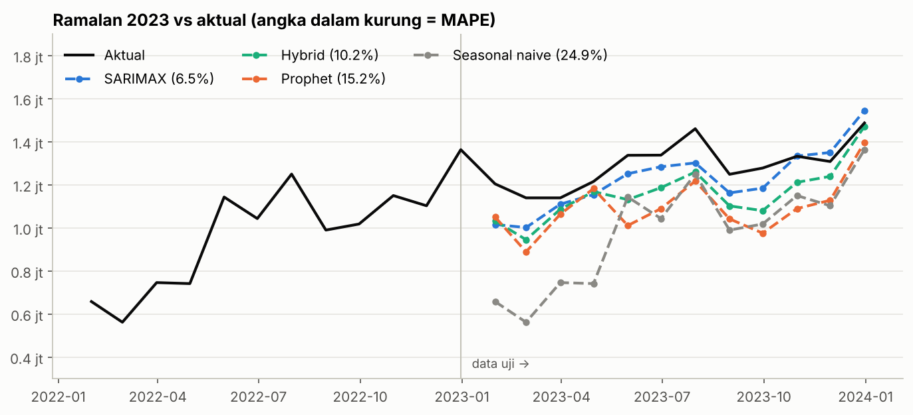
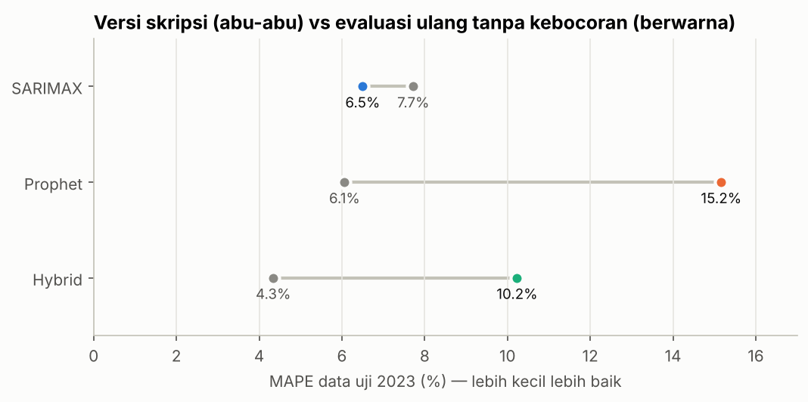
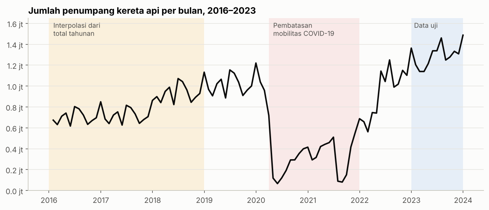

# Peramalan Jumlah Penumpang Kereta Api: SARIMAX vs Prophet vs Hybrid

Proyek ini berasal dari skripsi saya tentang peramalan jumlah penumpang kereta api bulanan. Setelah lulus, saya mengevaluasi ulang skripsi tersebut dan menemukan **kebocoran data (data leakage)**: parameter model dan bobot model hybrid dipilih dengan melihat skor di data uji. Repo ini menjalankan ulang seluruh analisis dengan prosedur yang benar dan membandingkan hasilnya dengan versi skripsi.

> **English summary.** Monthly railway passenger forecasting (Indonesia, 2016–2023) comparing SARIMAX, Prophet, and a SARIMAX–Prophet hybrid. My undergraduate thesis reported the hybrid as best (MAPE 4.3%), but its Prophet hyperparameters and hybrid weights were tuned on the test set. Re-run without leakage, **SARIMAX with COVID and Eid dummies wins (MAPE 6.5%)**, the hybrid drops to 10.2%, and Prophet to 15.2%. All models beat a seasonal-naive baseline (24.9%).



## Hasil utama

Data uji: Januari–Desember 2023 (12 bulan). Model dilatih dengan data 2016–2022.

| Model | MAPE | MAE (penumpang/bulan) | RMSE |
|---|---:|---:|---:|
| **SARIMAX** (0,1,2)(0,1,1)₁₂ + dummy COVID & Lebaran | **6,50%** | **82.958** | **98.233** |
| Hybrid (rata-rata 50/50) | 10,23% | 131.074 | 146.568 |
| Prophet (parameter default) | 15,16% | 196.080 | 214.893 |
| Seasonal naive (baseline) | 24,94% | 310.083 | 342.253 |

**Versi skripsi vs evaluasi ulang**



| Model | MAPE skripsi | MAPE evaluasi ulang | Penyebab perbedaan |
|---|---:|---:|---|
| Hybrid | 4,34% | 10,23% | bobot dioptimasi di data uji; komponen Prophet-nya ikut bocor |
| Prophet | 6,06% | 15,16% | `changepoint_prior_scale` dipilih berdasarkan MAPE data uji |
| SARIMAX | 7,72% | 6,50% | fitur libur diperbaiki (lihat di bawah) |

**Kesimpulan:** klaim skripsi bahwa model hybrid paling akurat tidak bertahan setelah kebocoran data dihilangkan. SARIMAX adalah model terbaik, dan versi ini lebih akurat daripada SARIMAX di skripsi.

## Apa yang salah di versi skripsi, dan apa yang diperbaiki

1. **Tuning parameter memakai data uji.** Parameter Prophet dicari dengan grid search dan Bayesian optimization yang targetnya MAPE 2023. Dengan cara ini MAPE Prophet turun dari 14,3% ke 5,7%, tapi itu skor terbaik dari banyak percobaan pada data yang sama, bukan perkiraan kinerja di data baru. Di [notebook 03](notebooks/03_prophet.ipynb), MAPE Prophet di data uji berubah antara 9,8% dan 18,2% hanya karena satu parameter.
   → *Perbaikan:* parameter Prophet memakai nilai default; ordo SARIMAX dipilih dengan AIC di data latih saja.

2. **Bobot hybrid dioptimasi di data uji.** Grid bobot 0–1 dievaluasi dengan MAE 2023. (Versi lain dengan Kalman filter bahkan memakai nilai aktual suatu bulan sebelum meramal bulan itu.)
   → *Perbaikan:* bobot 50/50 ditetapkan sebelum melihat data uji.

3. **Fitur libur hampir kosong.** Fitur `is_holiday` dibuat dengan mencocokkan tanggal akhir bulan dengan daftar tanggal libur harian, sehingga hanya 5 dari 96 bulan bernilai 1. Koefisiennya tidak signifikan (p = 0,86).
   → *Perbaikan:* dummy `lebaran` (bulan Idulfitri, yang bergeser tiap tahun) dan `covid` (April 2020 – Desember 2021).

4. **Tidak ada baseline.** Tanpa pembanding sederhana, tidak jelas apakah model benar-benar berguna.
   → *Perbaikan:* baseline seasonal naive. Semua model mengalahkannya.

## Keterbatasan data (penting dibaca)



- **Data 2016–2018 adalah hasil interpolasi.** Hanya total tahunannya yang tersedia; angka bulanannya dibagi memakai proporsi bulanan 2019. Artinya 36 dari 84 bulan data latih (43%) punya pola musiman buatan yang identik dengan 2019.
- **COVID-19 memotong seri waktu.** Penumpang turun sekitar 94% dari Januari ke Mei 2020. Akibatnya hanya ada satu tahun normal pasca-COVID (2022) di data latih, dan tahun itu pun masih tahun pemulihan.
- **Tidak ada data validasi yang layak.** Model yang dilatih sampai 2021 meleset sekitar 40% saat meramal 2022, apa pun parameternya, sehingga 2022 tidak bisa dipakai untuk tuning. Ini alasan parameter tidak di-tuning sama sekali.
- **Februari dan Maret 2023 bernilai identik** (1.139.583), kemungkinan besar salah input. Uji sensitivitas tanpa bulan Maret tidak mengubah urutan model.
- **Data uji hanya 12 bulan.** Selisih beberapa persen antar model belum tentu bermakna secara statistik.

## Struktur repo

```
├── data/
│   ├── raw/
│   │   ├── jumlah_penumpang_2016_2023.xlsx   # data bulanan 2016–2023
│   │   └── hari_libur_2016_2023.csv          # libur nasional & cuti bersama
│   └── processed/                            # hasil olahan & ramalan (dibuat oleh notebook)
├── notebooks/
│   ├── 01_data_dan_eda.ipynb                 # kualitas data, interpolasi, COVID, fitur
│   ├── 02_sarimax.ipynb                      # stasioneritas, seleksi AIC, diagnostik, ramalan
│   ├── 03_prophet.ipynb                      # ramalan, komponen, sensitivitas parameter
│   └── 04_hybrid_dan_perbandingan.ipynb      # hybrid, baseline, perbandingan dengan skripsi
├── src/forecasting.py                        # fungsi bersama (data, fitur, metrik, model)
├── images/
└── requirements.txt
```

## Cara menjalankan

```bash
pip install -r requirements.txt
jupyter notebook notebooks/
```

Jalankan notebook sesuai urutan nomor. Notebook 04 membaca hasil ramalan dari notebook 02 dan 03.

## Metodologi singkat

- **Pembagian data:** latih Jan 2016 – Des 2022 (84 bulan), uji Jan – Des 2023 (12 bulan). Data uji hanya dipakai sekali untuk evaluasi akhir.
- **SARIMAX:** d = 1, D = 1 (uji ADF), lalu 96 kombinasi ordo dan variabel eksogen dibandingkan dengan AIC di data latih.
- **Prophet:** parameter default, regresor `covid` dan `lebaran` (informasi yang sama dengan SARIMAX).
- **Hybrid:** rata-rata sederhana ramalan SARIMAX dan Prophet.
- **Metrik:** MAPE (utama, mudah dibaca dalam persen), MAE, dan RMSE.

## Tools

Python · pandas · statsmodels · Prophet · matplotlib

---

Muhamad Raihan Ramadhani Isworo · [github.com/gorengan11](https://github.com/gorengan11)
